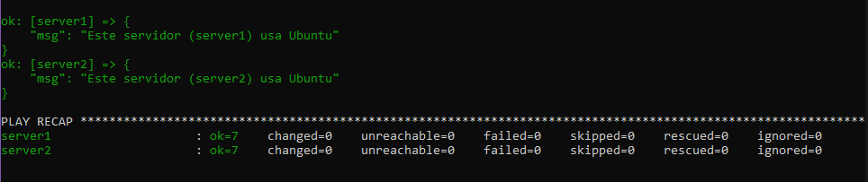

# Laboratorio Ansible con Docker

## Objetivo de la practica

Crear un laboratorio con dos servidores Linux (Ubuntu 24.04) usando Docker y administrarlos con Ansible mediante un inventario y un playbook.

## Iniciar los contenedores

```bash
docker compose up -d
docker ps
```

Instalar Python en cada servidor (requisito de Ansible):

```bash
docker exec server1 bash -c "apt update && apt install -y python3"
docker exec server2 bash -c "apt update && apt install -y python3"
```

## Nodo de control con Ansible

Ansible se ejecuta desde un contenedor auxiliar con acceso a Docker:

```bash
docker run -d --name ansible-control -v "${PWD}:/ansible" -v /var/run/docker.sock:/var/run/docker.sock -w /ansible -e ANSIBLE_HOST_KEY_CHECKING=False python:3.12-slim bash -c "apt-get update && apt-get install -y docker-cli && pip install ansible && sleep infinity"
```

## Comprobar la conexion

```bash
docker exec -it ansible-control ansible docker -i inventory.ini -m ping
```

## Ejecutar el playbook

```bash
docker exec -it ansible-control ansible-playbook -i inventory.ini playbook.yml
```

## Captura de la ejecucion exitosa



## Limpiar

```bash
docker rm -f ansible-control
docker compose down
```